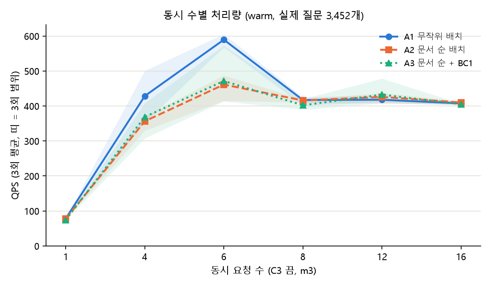
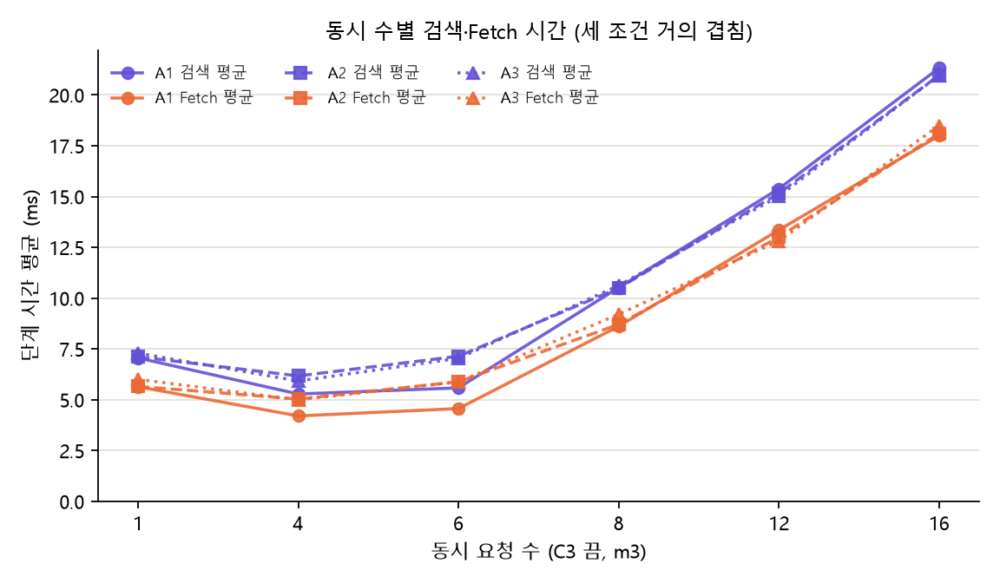

# w14-c3: C3 새 Observation 탐색 (14주차)

14주차 팀 계획의 C3 항목(고정 상한 조절이 아니라, C1·C2 특성을 쓸 수 있는 새 스케줄링 근거 찾기)에 대한 실험 기록이다.
판정 기준은 모두 계산·측정 전에 `rules/`에 고정했고, 결과를 본 뒤 바꾸지 않았다.

## 한 줄 결론
warm에서는 C1(배치)이나 C2(BC1)를 켜도 동시 실행 시 단계별 경합 모양이 바뀌지 않았다.
그래서 warm 기반 C3 새 후보는 모두 버렸다. 남은 후보는 cold의 "캐시 상주 인식 스케줄링" 하나이고, 메모리 제한 환경 결과를 보고 정한다.

## 폴더
| 경로 | 내용 |
|---|---|
| `rules/` | 판정 기준(측정 전 고정): 경향 분석 1 규칙, A 실험 규칙 + v1.1(예열 변경) + 판정→결정 연결표 |
| `results/trend1_offline/` | 경향 분석 1 결과 (기존 실험 결과 재분석, 서버 측정 없음) |
| `results/A_warm_concurrency_1128/` | A 실험 원시 결과: `runs_summary.csv`(실행 54개), `per_query.csv.gz`(질의 671,485줄, 예열 포함), `rec.csv`(2초 기록), 실행 로그, 스위치 status, 분석 결과 md |
| `figures/` | 처리량, 단계별 시간 그래프 |
| `code/` | C3 어댑터 `c3_m3trace.py`, 실행·기록·분석·그림 스크립트 |

## 1. 경향 분석 1 — 기존 결과 재분석 (2026-11-28)
- 데이터: 실제 질문 3,452개의 top-10 / 앞뒤 1조각 집합(13주차 결과, 파이프라인 top-10과 3,452/3,452 같음), C1 담당 cold 실험(질문 100개, 조회마다 release/load), 13주차 C3 측정의 질의별 시간.
- 블록 모델: 블록 = pk // 11,750(4MiB). cold 읽은 양 예측 오차 0~2%(문서 순·무작위 모두).
- **질의별 Fetch 비용 편차: 작음.** 하나씩 실행할 때 cold 지연 변동계수 0.17(평균 80ms, p90 100ms), warm 0.36. 기준 0.5 미만.
- **동시 질의 간 중복:** 동시 16개 사이 chunk 중복 0.04%. 블록 중복은 문서 순 37%, 무작위 52~75%이지만 전체 블록이 약 86개뿐이라 생기는 겹침으로 본다.
- **블록 기준 재정렬 모의(LRU):** 캐시 25%에서 블록 읽기 −19.6%, 50%에서 −9.96% → 기준(두 용량 모두 −10% 이상)에 못 미침.
- **Milvus 2.6.23 캐시 계층 소스 확인:** 같은 캐시 셀은 읽는 중이면 기다리고, 올라가 있으면 재사용한다(재읽기 없음). 교체는 LRU이지만 기본 설정은 교체가 꺼져 있다(`evictionEnabled: false`, 우리 서버 값은 미확인). 본문 mmap 경로(nq_seq)는 확인하지 않았다.

## 2. A 실험 — 동시 수에 따른 단계별 지연 (warm, 2026-11-28 15:38~16:40 KST)
- 실행기: 팀 pipeline-core(e36f40d) `main.py` + C3 어댑터 `m3trace_junlim`(C3 끔 = m3, 질의별 시각 기록만 추가). 팀 코드는 고치지 않음.
- 질문: 실제 NQ 질문 3,452개, 팀 고정 순서 순환. 검색 nq_seq top-10 / ef 64.
- 조건: A1 무작위 배치(w13c1_rand) + 이웃 없음 / A2 문서 순(w13c1_doc) + 이웃 없음 / A3 문서 순 + BC1. 본문은 셋 다 같은 읽기 경로(캐시 계층, mmap 없음)라 A1 vs A2는 배치만, A2 vs A3는 C2만 다르다.
- 동시 수 1, 4, 6, 8, 12, 16 × 3회, 회차마다 18칸 순서를 섞음. 실행마다 예열 15초 + 측정 20초, load → 측정 → release.
- **유효 54/54** (오류 0, 측정 구간 저장소 읽기 ≤ 1MiB, 재시작 없음). 장치 읽기(diskstats) ≈ 0 → warm.

### 처리량 (QPS, 3회 평균 [범위])
| 동시 | 1 | 4 | 6 | 8 | 12 | 16 |
|---|---|---|---|---|---|---|
| A1 무작위 | 78 [77~80] | 429 [353~501] | 590 [568~605] | 417 [401~425] | 418 [411~431] | 407 [402~413] |
| A2 문서 순 | 78 [76~80] | 356 [329~371] | 461 [415~488] | 416 [410~419] | 426 [407~438] | 410 [405~414] |
| A3 문서 순 + BC1 | 75 [73~75] | 369 [308~408] | 472 [414~573] | 402 [389~420] | 433 [408~479] | 405 [403~407] |

### 사전 규칙 판정
- J2 주요 지연 증가 단계: 세 조건 모두 **"고르게 증가"**. 동시 1→16에서 검색 +13.7~14.3ms, Fetch +12.4~12.5ms(Fetch 몫 46~48%, 기준 60%).
- J3 조건 간 차이: 배치(A1 vs A2), C2(A2 vs A3) 모두 **"차이 확인 안 됨"**. Fetch 몫 차이 회차별 −0.8~+1.3%p(기준 20%p).
- J1 처리량 꺾임: 세 조건 모두 최고는 동시 6. 규칙상 꺾임 위치는 A1 8, A2·A3 16이지만, 값은 세 조건 모두 동시 8~16에서 400~430으로 평평하다.

### 결정 (`rules/C3_A실험_결정표.md`, 결과 보기 전에 작성)
- Fetch 단계만 조절하는 방식(12주차 m6류): 버림(warm).
- warm에서 C1·C2와 이어지는 C3 새 기여: 버림.
- 남은 후보: cold의 캐시 상주 인식 스케줄링(문서 순 배치로 읽을 블록을 실행 전에 알 수 있다는 점 이용). 메모리 제한 환경에서 캐시 적중·미스 질의가 섞여 나오는지가 관문.

### 판정 외 관찰 (결과를 본 뒤의 기술, 결론 아님)
- 동시 6 → 8에서 처리량이 약 30% 떨어지는데 Milvus CPU는 6.0~6.4 → 6.7~6.8코어로 오히려 조금 오른다(클라이언트 포함 합 약 7.7~7.9코어). 원인 미확인.
- 동시 6은 실행마다 400대/500대로 갈린다. A1이 3번 모두 높은 쪽이었고, 같은 nq_seq를 쓰는 검색 시간도 A1이 짧았다 → 배치 효과라기보다 실행 시점의 서버 상태일 가능성(미확인).
- Fetch 시간 변동계수: 동시 1에서 0.3~0.4 → 동시 8 이상 1.1~1.3. 세 조건 같음 → 편차는 질의 비용이 아니라 경합에서 온다.
- 실제로 동시에 진행된 Fetch 사이 chunk 공유 질의 비율 0.1~0.3%.
- 13주차 통합 측정에서 상한 8이 처리량 이득을 내지 못한 것과 맞는 정황(동시 8은 이미 떨어진 구간). 상한 실험은 하지 않았다.

### 한계
- warm만 측정했다. 읽기 바이트·블록·디스크 병목은 warm에서 0이라 비교할 수 없다.
- 본문을 팀 통합 경로(nq_seq, mmap)가 아니라 C1 비교 컬렉션에서 읽었다.
- 기준값(0.9, 60%, 20%p 등)은 강한 근거가 없다. 이번 값은 기준에서 멀어 결론이 흔들리지 않는다.

### 실행 기록
- 첫 세션(예열 5초)은 실행 3개 뒤 멈췄다. 값을 보기 전에 "동시 1에서 예열 5초면 측정 구간에 저장소를 읽어 무효가 될 수 있다"는 문제를 찾아 예열을 15초로 바꿨다(`rules/C3_A실험_규칙_v1.1.md`). 첫 세션은 판정에 쓰지 않는다.
- 첫 세션을 tmux에 Ctrl-C로 멈출 때 실행 중이던 main.py가 release 전에 끊겨 컬렉션 2개가 Loaded로 남았다 → 서버가 조용한 것을 확인하고 release했다. 멈출 때는 `pkill -TERM -f run_c3a2_v11.sh`를 쓴다.

## 재현
- 서버: `/workspace/junlim/c3a2/`에 팀 pipeline-core e36f40d 사본 + `modules/c3_m3trace.py`를 두고
  `WINDOW="YYYY-MM-DD HH:MM~YYYY-MM-DD HH:MM" bash run_c3a2_v11.sh` (tmux 안, 약 1시간). 분석 `python analyze_c3a2.py --sess <SESS> --warm 15`.
- `results.jsonl`(질의별 검색 결과, 810MB)은 용량 때문에 넣지 않았다. 동시 Fetch 중복 계산은 이 파일이 필요하다(서버 `c3a2_1128_0740.tgz`).
- 파일 md5(앞 8자리): c3_m3trace.py f2f6460a, rec_c3a2.py 3d1b3eb8, run_c3a2.sh 4e0e0cb3, run_c3a2_v11.sh 4d5acc63, analyze_c3a2.py c3ce2f1b, plot_c3a2.py 0a36e7ce, analyze1.py 82b5c611 (원본 기준. `code/`의 실행 스크립트는 관리자 스위치 주소를 가려서 md5가 다르다).
- 서버 주소, 관리자 스위치 주소, 다른 계정 프로세스의 명령줄은 가렸다.
