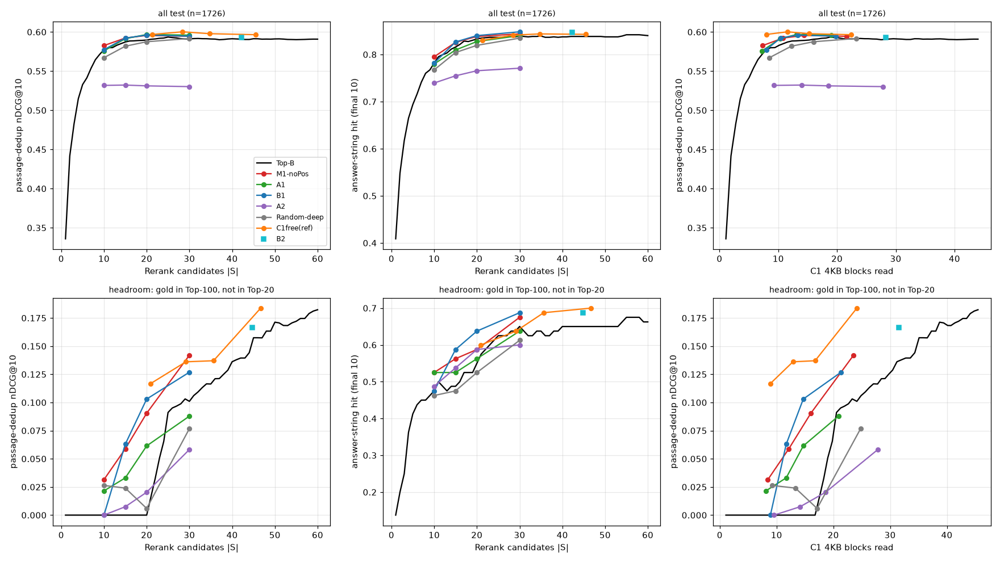
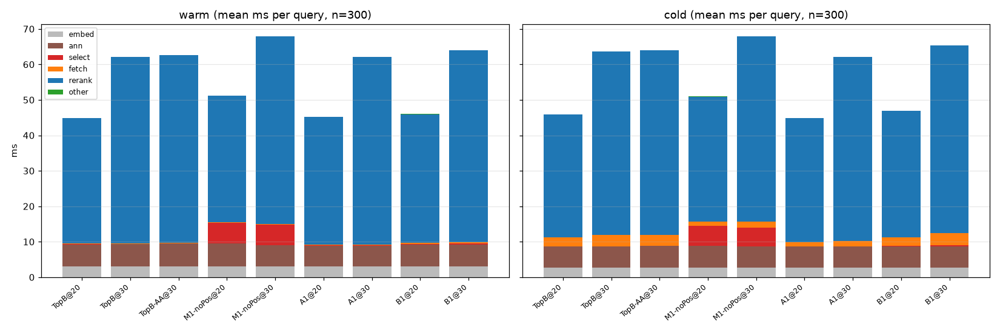

# REPORT: Selective Context Fetch v2 (후보 선별)

- 2026-11-22, `/workspace/jaeeun/sel_fetch_v2/`. 설정은 PLAN.md(변경 기록 포함), 진행은 PROGRESS.md에 있다.
- 데이터: NQ 100만 chunk (문서 순), MiniLM 임베딩, Milvus HNSW ef=256, Reranker ms-marco-MiniLM-L-6-v2
- 분할: 3,452개 질문을 seed 20261122로 나눔. dev 1,726개(튜닝, 진단), test 1,726개(최종 비교 1회)
- 통계: 질문 단위 paired bootstrap 2,000회, 95% CI
- 재현: 결과 폴더마다 `config.json`이 있다 (패키지 버전, seed, 명령). GPU는 A2 (CUDA_VISIBLE_DEVICES=0)

## 결론 요약
| 질문 | 답 |
|---|---|
| Top-B 밖에서 Rerank 후 중요해지는 후보를 Fetch 전에 싸게 찾을 수 있나 | **부분적으로 가능.** 학습 없는 B1(피드백)이 그런 후보의 20%를 확보 (M1-noPos 15%, 무작위 4%). headroom 질문에서는 nDCG +0.10. 그러나 전체 질문 기준 품질 이득은 +0.006으로 작다 |
| 학습 없는 방법으로 M1-noPos를 대체할 수 있나 | **가능.** A1과 B1 모두 B≥15에서 M1-noPos와 차이가 없다 (CI가 0 포함) |
| 채택 (사전 규칙) | 모든 방법의 이득이 nDCG 0.01, 정답 포함률 1%p 미만 → **Top-B (B=20)** 채택. 연구용 후보로는 A1과 B1을 유지 |
| 선별이 end-to-end 지연시간을 줄이나 | 같은 \|S\|에서 비교하면 **(b)** (A1, cold에서 −1.1ms ≈ 2%) / **(c)** (M1-noPos +5~6ms, B1 +1ms). 병목은 Rerank로, 전체의 85%를 차지한다. 지연시간 개선은 거의 전부 **Rerank 비용 절감(\|S\| 축소)**에서 나오고, 이는 Top-B의 B를 줄이는 것만으로도 대부분 얻는다 |

## 1) 기존 실험 요약과 미해결 문제
| 항목 | 지난주 | 이번 재분석 (dev) |
|---|---|---|
| 선별 | M1-noPos (HGB 18개 피처, 같은 3,452개 질문으로 5-fold 학습) | dev로만 다시 학습 |
| 같은 B=20, Top-B 대비 | 보존율 +2.2%p | 보존율 +2.2%p, nDCG +0.0100 [.006, .014], Hit +1.1%p |
| 지연시간 | Fetch만 측정, 고정 순서 1회 → 판단 보류 | 로그 재분석: readahead로 디바이스 읽기가 앱 요청의 6~8.7배, TopK100 첫 300개 질문 16.4ms vs 나머지 2.5ms, Select28이 Select30보다 느림 → 순서·캐시 잡음이 지배적 |
| 비용 구성 | – | Rerank가 후보 1개당 1.7ms로 지배적이고, Fetch는 Fetch+Rerank의 3.8% |
| 로지스틱 회귀 (순위·점수 격차·같은 문서 후보 수) | – | 선택 결과가 Top-B와 같음. "같은 문서 후보 수"의 **선형** 계수가 0.006 → **선형 개수로는 신호가 없었다** |
| 보존율의 타당성 | 주 지표로 씀 | 같은 \|S\|에서 보존율은 낮아도 nDCG가 높은 경우가 있음 → 대리 지표로 쓸 수 없음 |

## 2) 기법 정리, 선행 연구, ConStore와의 차이
문헌 조사는 사용자 지시로 생략했다. 아래 인용은 기억에 의존했고 **미확인**이다.
| 방법 | 핵심 | 학습 | 선행 연구 (미확인) | 이번에 한 것 |
|---|---|---|---|---|
| A1 Document-aware 집중형 | 문서 점수 = max(ANN)×log(1+후보 수). 상위 문서의 후보를 Top-B 밖에서 끌어올림 | 없음 (dev에서 2개 값 선택) | MaxP/CombSUM 계열 | test 비교, e2e |
| A2 다양성형 | 문서당 c개 상한 | 없음 | MMR (Carbonell & Goldstein 1998) | test 비교 |
| B1 Iterative/Feedback | Top-10 Rerank → CE 상위 3개와 임베딩이 가깝거나 같은 문서인 후보로 다음 10개 선택 | 없음 (2개 값 선택) | GAR (CIKM'22), LADR (SIGIR'23) | test 비교, e2e |
| B2 조기 종료 | B1을 10개씩 늘리다가 새 후보가 Top-10에 못 들면 멈춤 | 없음 | cascade / early exit | test 비교 (e2e 안 함) |
| Adaptive-k | 몇 개를 고를지 정함 | 없음 | Adaptive-k retrieval | 실행 안 함 (보조) |
| Hybrid RRF | BM25+Dense | – | – | BM25 인덱스가 없어 실행 안 함 |

- **B1과 GAR·LADR·cascade의 차이:** GAR는 Rerank 점수가 높은 문서의 corpus graph 이웃을 번갈아 Rerank하고, LADR은 lexical seed에서 시작해 dense 이웃 그래프를 탐색한다. B1은 이 아이디어를 **ANN Top-100 안으로 제한**한 버전이다. 그래프를 미리 만들 필요가 없고 새 검색도 하지 않으며, Fetch I/O를 비용으로 계측한다는 점만 다르다. **알고리즘 자체의 차별점은 거의 없다.** cascade ranking은 싼 점수에서 비싼 점수로 단계적으로 거르는 방식이고, Rerank 결과를 피드백으로 쓰지 않는다는 점에서 B1과 다르다.
- **ConStore와의 차이:** ConStore는 Query Log의 공동 검색 그래프로 **배치를 바꾸는** 방법이고(팀원 재현 P64), 우리 선별은 배치를 고정한 채 **무엇을 읽을지 고르는** 방법이다. M1-noPos는 과거 Rerank 결과(로그)로 학습하므로 ConStore와 같은 한계(로그 의존, 분포 변화 시 재학습)를 가진다. A1과 B1은 로그가 필요 없다.

## 3) 방법 선정 근거 (1단계 숫자)
| 근거 (dev) | 선정 |
|---|---|
| Top-20이 놓친 기준 Top-10의 49%가 이미 고른 문서 안에 있음. 같은 문서 개수의 선형 신호는 0 → **문서 단위 집계라는 다른 가설** | A1 (집중형), A2 (대조, 예측: 불리) |
| Rerank가 비용의 지배 구간 → Rerank 결과를 다음 선택에 쓰는 것은 Fetch 전 정보만 쓰는 것보다 정보가 많다 | B1, B2 |
| C1이 읽은 블록 안에 후보 14.6개 (Top-20 기준) | C1 확장. C2와 역할이 겹쳐서 **참고용으로만** |

## 4) 실험별 질문 → 가설 → 결과 → 해석 (test 1,726개, B=20, Top-B 대비)
Top-B@20 기준값: 중복 제거 nDCG 0.5897, 정답 문자열 포함률 0.8329 (답이 있는 2,254개 질문).
| 방법 | 가설 | 중복 제거 nDCG Δ | 정답 문자열 Δ | 승격 회수율 | 해석 |
|---|---|---|---|---|---|
| M1-noPos (dev 학습) | 기준선 | +0.0059 [.002, .010] | +0.5%p (CI가 0 포함) | 0.150 | 지난주보다 작음 |
| A1 집중형 | 학습 없이 M1 이득 일부 재현 | **+0.0070 [.003, .011]** | −0.5%p (CI가 0 포함) | 0.116 | M1과 같은 수준 (A1−M1 +0.0012 [−.003, .005]) |
| A2 다양성형 (c=3) | 불리할 것 | −0.0585 | −6.7%p | 0.109 | 가설대로 불리. 정답이 한 문서에 몰려 있음 |
| B1 피드백 | Rerank 피드백으로 숨은 후보 발굴 | +0.0063 [.001, .011] | +0.7%p (CI가 0 포함) | **0.203** | 핵심 질문에 가장 근접 (B1−M1 +0.0005 [−.005, .006]) |
| B2 조기 종료 | 필요한 질문에서만 더 읽음 | +0.0013 (CI가 0 포함, 평균 \|S\| 42) | **+1.1%p [0.3, 1.9]** | 0.359 | 정답 포함률만 개선, \|S\|가 늘어남 |
| Random-deep | 대조 | −0.0022 (CI가 0 포함) | −1.4%p | 0.043 | 무작위로 깊이 읽으면 손해 |
| C1 확장 (참고) | 블록 비용 0 | +0.0071 (평균 \|S\| 34.7) | +0.8%p (CI가 0 포함) | 0.233 | 아래 분해 참고 |

- **B=10에서는** A1(−0.0015)과 B1(=Top-B, 정의상 같음)이 M1-noPos보다 나쁘다. 학습 없는 방법의 이득은 B≥15에서만 나타난다.
- **headroom 질문** (정답이 Top-100 안, Top-20 밖, n=134): 중복 제거 nDCG Δ는 B1 +0.103 [.068, .146], M1 +0.091, A1 +0.061. Top-20을 기준으로 정의한 부분집합이라 Top-B는 정의상 0이다.
- **M1-noPos와의 관계 (B=20):**

| 방법 | Top-B 밖에서 고른 후보 수 | 그중 M1-noPos도 고른 비율 | 고른 후보의 정밀도 (기준 Top-10) | M1-noPos가 놓친 후보 확보율 | 고른 후보의 평균 ANN 순위 |
|---|---|---|---|---|---|
| M1-noPos | 2.9 | 1.00 | 0.161 | 0 | 33.1 |
| A1 | 4.1 | 0.20 | 0.089 | 7.7% | 37.8 |
| B1 | 4.5 | 0.26 | 0.142 | 13.3% | 36.7 |
| Random-deep | 3.8 | 0.04 | 0.035 | 4.4% | 59.6 |

  → A1과 B1은 M1-noPos와 **다른 후보를 고르는데도** 같은 품질을 낸다. 이들이 Top-B보다 나은 이유는 고른 후보의 정밀도가 무작위의 2.5~4배이기 때문이다 (문서 신호, Rerank 피드백).
- **사례 (B=20):** A1은 문서가 집중된 질문(ANN Top-10의 문서 ≤5개, n=970)에서 +0.0089 [.004, .014]로 유의했다. B1은 문서가 분산된 질문(n=756)에서 +0.0102 [.003, .019]로 유의했다. 이득이 가장 큰 사례 6개에서 새로 들어온 정답은 모두 **Top-B에 이미 있던 문서의 다른 chunk**였고, ANN 순위는 21~66이었다. 예: "who played the face in the a team"에서 B1이 66위 정답(CE 상위 3개와 cos 0.67)을 찾았다. 그래서 두 방법이 찾는 것은 주로 "같은 문서 안의 깊은 순위 chunk"다. 다른 문서의 새 정답을 찾는 능력은 이번 데이터로 확인하지 못했다.
- **C1 확장의 원인 분해 (test, B=10, 평균 \|S\| 21.3):**
  - raw nDCG는 같은 \|S\|의 Top-B보다 +0.0187인데, 중복 제거 nDCG로는 **+0.0078**이다. 이득의 약 58%가 중복 라벨에서 온다.
  - 개선된 402개 질문에서 새로 들어온 정답 chunk 230개 중 146개(63%)는 이미 Top-10에 있던 정답 passage의 다른 chunk였고, 84개만 새 passage였다.
  - Reranker 오류 감소도 있다: 중복 제거 nDCG가 전체 Rerank보다 좋은 질문이 18.4%, 나쁜 질문이 4.7%였다.
  - Top-B 자체도 중복 제거 nDCG가 B=30에서 0.5912로 가장 높고 B=100에서는 0.5891로 떨어진다 → 깊은 후보가 CE 오류(distractor)를 만든다.

## 5) 비용–품질 곡선

- 위쪽은 전체 test, 아래쪽은 headroom 질문이다. 열은 차례로 \|S\| 대비 중복 제거 nDCG, \|S\| 대비 정답 포함률, C1 블록 대비 중복 제거 nDCG다.
- 전체 질문에서는 Top-B 곡선이 B≈20부터 평평해서, 어떤 방법이든 위로 올라갈 여지가 0.01 이하다.

## 6) End-to-end (질문 300개, warmup 30개 제외, 질문마다 방식 순서를 순환, GPU0, 측정 중 다른 GPU 작업 없음)

| 구간 (Top-B@30, 평균 ms) | 임베딩 | ANN (Milvus) | 선별 | Fetch | Rerank | 합계 (p50 / p95 / p99) |
|---|---|---|---|---|---|---|
| warm | 3.0 | 6.3 | 0.0 | 0.21 (0.3%) | 52.6 (85%) | 62.1 (58.2 / 77.0 / 93.1) |
| cold (Fetch O_DIRECT) | 2.8 | 6.0 | 0.0 | 3.14 (4.9%) | 51.7 (81%) | 63.6 (60.9 / 77.0 / 88.2) |

- 선별로 줄일 수 있는 최대 폭은 (Fetch+Rerank)/합계 = 85~86%이고, 그중 Fetch 몫은 0.3~4.9%다.
- **A/A 잡음:** warm +0.52 [0.36, 0.71]ms, cold +0.32 [0.09, 0.54]ms. 이를 δ = 0.71 / 0.54ms로 둔다. A/A 슬롯이 늘 Top-B@30 바로 뒤에 와서 생긴 작은 순서 효과로 보인다.

| 비교 (paired, 같은 질문) | warm Δ (ms) | cold Δ (ms) | 판정 |
|---|---|---|---|
| A1@20 − Top-B@20 (같은 \|S\|) | +0.32 [−0.09, 0.75] | **−1.07 [−1.51, −0.61]** (Fetch −1.55) | warm 차이 없음 / cold 소폭 빠름 → (b) |
| B1@20 − Top-B@20 | +1.10 | +0.96 | 느림 (Rerank 2회 호출) → (c) |
| M1-noPos@20 − Top-B@20 | +6.31 | +5.01 | 느림 (선별 5.9ms) → (c) |
| X@20 − Top-B@30 (품질이 같거나 높음) | M1 −10.9, A1 −16.9, B1 −16.2 | −12.7 / −18.8 / −16.7 | 빠름. 다만 Top-B@20도 −17.2/−17.7이고 품질 차이는 −0.0015 |

- **결론:** 같은 \|S\|에서 선별 방법 자체는 **(b) Fetch는 줄지만 Rerank가 지배적이라 효과가 미미하다** (A1). M1-noPos와 B1은 **(c) 선별·피드백 오버헤드 때문에 오히려 느려진다.** 지연시간 이득은 \|S\|를 30에서 20으로 줄이는 데서 오고(Rerank 비용 절감), 이는 Top-B만으로도 얻는다.
- **I/O 효과의 성립 조건 (손익분기):** cold Fetch는 블록당 0.131ms다. A1은 블록 2.2개를 아끼고 오버헤드는 0.1ms라서, 블록당 0.05ms 이상이면 이득이다 (로컬 cold에서 이미 성립, 크기 약 1ms). M1-noPos가 이득을 내려면 블록당 6.1ms 이상이어야 하고, 원격·콜드 저장소 수준에서만 성립한다. B1은 라운드마다 Fetch 왕복이 추가되므로, 왕복 지연이 큰 저장소에서는 더 불리해진다.
- 한계: Milvus 캐시 비우기(reclaim)는 승인을 받지 않아 하지 않았다 (Milvus는 warm만 측정). A2 GPU에서 Rerank는 후보 1개당 약 1.7ms다. `/workspace`는 loop 장치(dio=1)이고, 그 아래 실제 장치 종류는 확인하지 못했다. 동시 요청 조건은 재지 않았다.

## 7) 채택 결론, 한계, 다음 단계
- **채택 (사전 규칙 §4.4): Top-B, B=20.** A1, B1, M1-noPos의 이득은 CI가 0을 포함하지 않지만 nDCG 0.01 미만, 정답 포함률 1%p 미만이다. M1-noPos는 학습 데이터가 필요하고 5~6ms 오버헤드까지 있어 채택하지 않는다.
- **연구는 계속한다.** 학습 없는 A1과 B1이 M1-noPos와 같은 수준이고, B1은 Top-B 밖 승격 후보 회수율(0.20)과 headroom 질문 개선(+0.10)에서 가장 좋다. 핵심 질문에 대한 답은 "찾을 수는 있지만, 전체 품질 곡선이 B≈20에서 평평해서 이득이 작다"이다.
- **한계:** 데이터셋 1개(NQ, passage가 평균 2.3개 chunk에 걸침), Reranker 1개, dev와 test가 같은 분포, headroom을 Top-20 기준으로 정의, 문헌 확인 안 함 (GAR/LADR은 미확인), M1-noPos 온라인 피처 구현이 최적화되지 않음 (선별 5.9ms는 이 구현 기준이며, 온라인 선택 결과가 오프라인과 같은지 대조하지 않음), 고른 후보의 "같은 문서 비율" 집계에 코드 버그(NaN)가 있어 사례 6개로만 확인, B2는 e2e에서 재지 않음.
- **다음에 검증할 것 (C2와 결합할 때):** (1) A1과 B1이 고르는 "같은 문서의 깊은 chunk"가 C2 이웃 규칙(B, C2-규칙C1)과 얼마나 겹치는지. 겹치면 A1은 C2로 흡수된다. (2) 다른 문서의 새 정답을 찾는 능력을 다문서 데이터셋(예: FiQA)에서 확인. (3) 더 큰 Reranker에서는 후보당 비용이 커지므로 \|S\| 축소의 가치가 커지는지. (4) Milvus reclaim 승인 후 cold 경로를 재고, 원격 저장소 지연을 가정한 손익분기를 확인.
